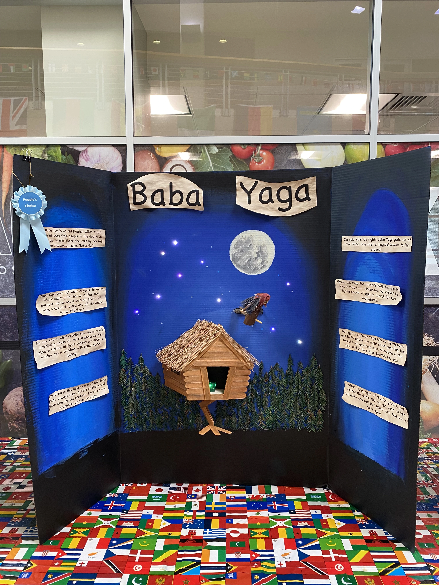

# PosterOS — Arduino firmware that brings a fairytale poster to life

College project · October 2022 · Team: Max Dokukin (LED hardware and firmware) with one teammate (poster design) · Status: Completed

Poster for a competition with live LED lights controlled by Arduino. Software for a live poster. Multiple lighting effects. Arduino based.

<video src="static/media/resources/IMG_0677_optimized.mp4" poster="static/media/thumbnails/IMG_0677_optimized_thumbnail.webp" controls muted loop playsinline width="480"></video>



## Overview

PosterOS is the firmware for a three-panel poster about the Russian fairytale witch Baba Yaga. Addressable LEDs set into the
artwork make the scene move: ten stars twinkle in the night sky, a cauldron inside Baba Yaga's hut ("izbushka") bubbles in
random colors, and the hut's window flashes in bursts. The sketch runs on an Arduino, drives two NeoPixel strips (27 LEDs)
through the Adafruit NeoPixel library, and schedules every effect as timed color fades in per-LED queues, so the loop never
blocks. The poster won a People's Choice ribbon at the competition where it was shown.

## Highlights

- 27 addressable LEDs on 2 data pins: 10 stars (pin 3) and a 17-LED house strip (pin 5) split into 8 cauldron LEDs and one 9-LED window cluster — `PosterOS.ino`, `PosterController.h`
- Three randomized effects (stars, cauldron, window) built on one primitive: a timed linear fade between two 24-bit colors — `LedInstruction.h`, `AdvancedLed.h`
- Non-blocking scheduler: no `delay()`; effects are queued against `millis()` and frames are pushed at most every 10 ms — `PosterController.h`
- Compiles today for an Arduino Nano to 7,342 bytes of flash (23% of 30,720) and 25 bytes of static RAM (checked with arduino-cli, AVR core 1.8.8, Adafruit NeoPixel 1.15.5)
- People's Choice ribbon at the competition — photo `static/media/resources/IMG_0713.webp`

## How it works

```
loop() → PosterController.frame()  (every ≥ 10 ms)
           ├─ stars()    ─┐
           ├─ cauldron() ─┼─ push LedInstruction{start ms, end ms, from color, to color} onto per-LED queues
           └─ window()   ─┘
         → AdvancedLEDcontroller.frame() → AdvancedLed.frame() interpolates the head instruction → strip.show()
```

- **`PosterOS.ino`** — pin and LED-count constants (`IZBA_LEDS 17` on pin 5, `STAR_LEDS 10` on pin 3, `MAX_BRIGHTNESS 255`), creates the `PosterController` and calls `frame()` from `loop()`.
- **`PosterController.h`** — owns both `Adafruit_NeoPixel` strips (`NEO_GRB + NEO_KHZ800`) and the three effect generators:
  - *Stars*: each frame a 1-in-50 chance picks one of 10 stars, fades it from dim grey (`0x555555`) to white over 100–500 ms, holds 0–1000 ms, and fades back.
  - *Cauldron*: each frame a 2-in-100 chance lights one of 8 LEDs in yellow, green or dark red, fading in and out over 500–1000 ms each; for the lower four LEDs a neighbour 3–4 positions up follows with a delayed fade, like a rising bubble.
  - *Window*: every 2–5 s, after a 0–1 s delay, the 9-LED window cluster blinks 1–3 times in red, green, yellow or white (red weighted twice).
- **`AdvancedLEDcontroller.h`** — an array of `AdvancedLed` objects for one strip; routes instructions by LED id, can group consecutive pixels into one cluster (`setBulk`), and calls `strip->show()` once per frame.
- **`AdvancedLed.h`** — one logical LED (or cluster) with a linked-list queue of instructions; waits until the head instruction's start time, mixes the two colors per channel by elapsed fraction, then writes the end color and frees the node.
- **`LedInstruction.h`** — the queue node: start time, end time, start color, end color, `next`.

## Results

| Metric | Value | Note |
|---|---|---|
| Competition result | People's Choice ribbon | photo `static/media/resources/IMG_0713.webp` |
| LEDs driven | 27 (10 stars + 8 cauldron + 9 window) | `PosterOS.ino`, `PosterController.h` |
| Flash use (Arduino Nano) | 7,342 / 30,720 bytes (23%) | arduino-cli compile, 2026-09-27 |
| Static RAM (globals) | 25 / 2,048 bytes | heap objects (controllers, queues) allocated at run time are not included |
| Source size | 5 files, 291 lines | `wc -l` |

The figures describe the firmware; there are no performance measurements beyond the build size.

## Getting started

```bash
# Arduino needs the sketch folder to be named like the .ino file
git clone https://github.com/xewe-labs/xewe-led-poster-os.git PosterOS
arduino-cli core install arduino:avr
arduino-cli lib install "Adafruit NeoPixel"
arduino-cli compile --fqbn arduino:avr:nano PosterOS
arduino-cli upload  --fqbn arduino:avr:nano -p <serial port> PosterOS
```

Requirements: an Arduino Nano (or another AVR Arduino), a 10-LED addressable strip on pin 3 (stars), a 17-LED addressable strip on
pin 5 (8 cauldron LEDs followed by a 9-LED window panel), GRB color order at 800 kHz, and a power supply sized for the LEDs.
The Arduino IDE works too: open `PosterOS/PosterOS.ino` and install "Adafruit NeoPixel" from the Library Manager.

## Documents

- Demo video: [static/media/resources/IMG_0677_optimized.mp4](static/media/resources/IMG_0677_optimized.mp4)
- Build photo — the 3 × 3 LED panel: [static/media/resources/IMG_0611.webp](static/media/resources/IMG_0611.webp)
- Poster photo from the original README (IMG_0628):

  
- Related: [XeWe LED OS](https://maxdokukin.com/projects/xewe-led-os) — the same author's ESP32 operating system for addressable LEDs ([GitHub](https://github.com/xewe-labs/xewe-led-os))
- Project page: [maxdokukin.com/projects/xewe-led-poster-os](https://maxdokukin.com/projects/xewe-led-poster-os)
